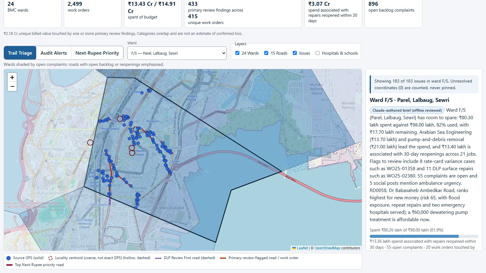
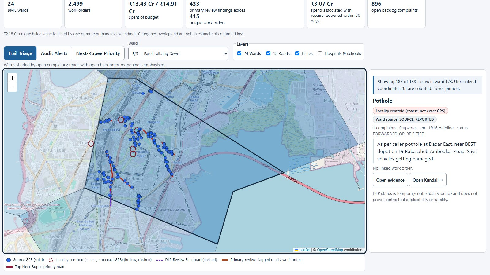
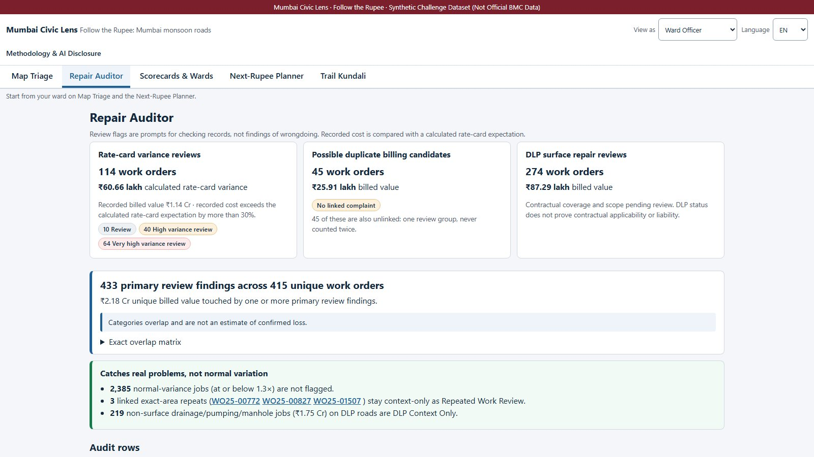
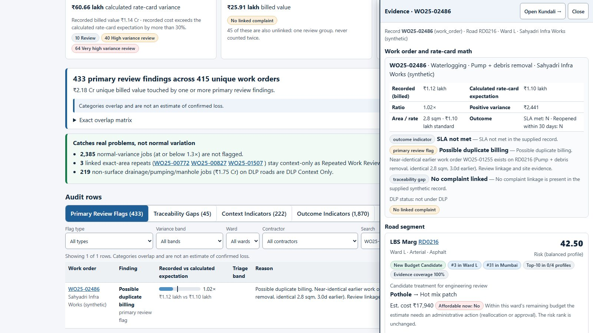
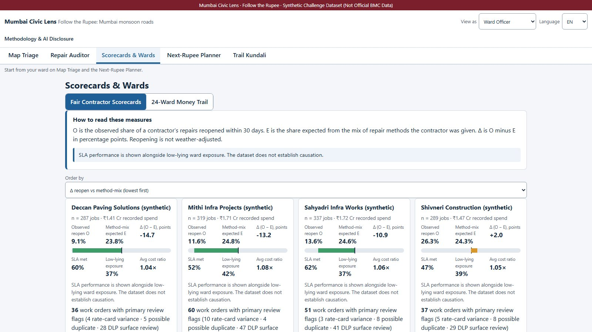
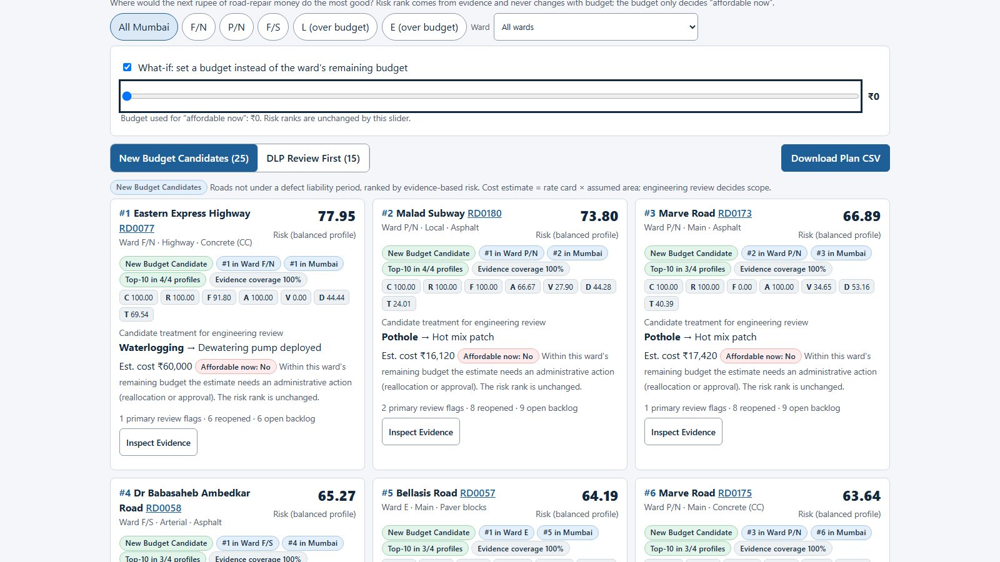
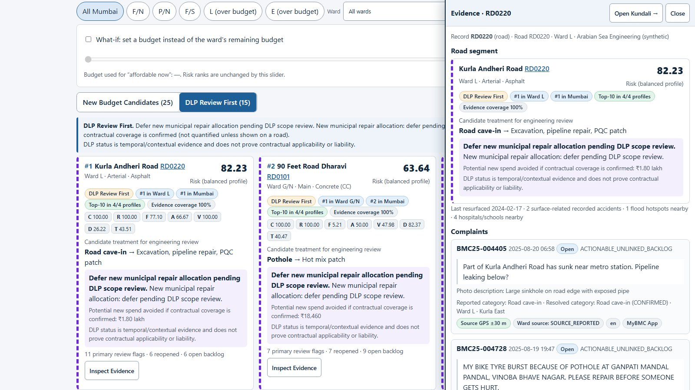
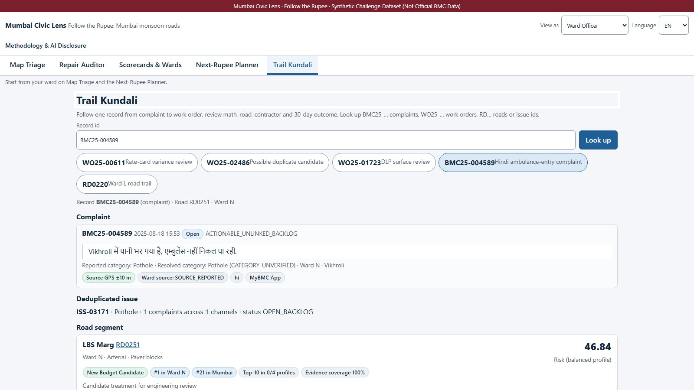

# Mumbai Civic Lens — Follow the Rupee

<!-- VIDEO_LINK_START -->
## ▶ Watch the 3-minute demo

**Demo video (YouTube, unlisted):** https://youtu.be/ZRAC-8WIdjA
<!-- VIDEO_LINK_END -->

> **Synthetic challenge dataset.** This project uses the synthetic dataset of the *Claude Impact Lab Mumbai* challenge "Follow the Rupee: Mumbai Monsoon Roads". It is **not official BMC data**: contractors, amounts, dates, coordinates and transactions are fictional. Real Mumbai place names appear only for realism. Nothing here is a finding about any real person, contractor or department.

**One question:** *where did each ward's monsoon road-repair money go, did the fix hold, and where should the next rupee go?*

Mumbai Civic Lens turns 6,501 messy multilingual complaints, 2,499 repair work orders, a rate card, 291 road segments and risk data (flooding, accidents, hospitals and schools) into **one evidence trail** a citizen, ward officer or corporator can follow: complaint → work order and rate-card math → road → contractor → 30-day outcome.

DLP = **Defect Liability Period**: the window in which a contractor may still be contractually responsible for repair defects. The app treats DLP status as context only; it never proves liability.

## What you can do in the app

| View | What it shows |
|---|---|
| **Map Triage** | All 24 wards, 291 roads, complaint markers. Solid dots are **source GPS**; hollow dashed rings are **locality centroids (coarse, not exact GPS)**; unresolved coordinates are counted, never pinned. |
| **Repair Auditor** | **433 primary review findings across 415 unique work orders** (₹2.18 Cr unique billed value touched), shown as three separate, non-additive figures, with the permanent line *"Categories overlap and are not an estimate of confirmed loss."* False-positive shields and a downloadable Audit CSV. |
| **Scorecards & Wards** | Fair contractor scorecards: observed reopen rate **O** against the method-mix expectation **E**, SLA beside low-lying exposure with a non-causal note, **no letter grades**. A 24-ward money trail. |
| **Next-Rupee Planner** | New Budget Candidates vs **DLP Review First**, with ward rank and citywide lane rank side by side. Risk rank never changes with budget; setting the what-if budget to ₹0 flips only "Affordable now". |
| **Trail Kundali** | Look up any complaint (`BMC25-…`), work order (`WO25-…`) or road (`RD…`) and follow its connected trail, including Hindi and Marathi complaints. |

### Screenshots (live app, 1600×900)

| | |
|---|---|
|  |  |
|  |  |
|  |  |
|  |  |

## How Claude was used (disclosure)

Claude was used during development for multilingual interpretation and reviewed plain-language explanations grounded in deterministic PostGIS calculations. **All monetary calculations, audit rules and rankings are deterministic and reproducible.** The live demo works offline and calls no model. Ward and contractor briefs carry an author badge: "Claude-authored brief (offline reviewed)" only where the stored row says so, otherwise "Deterministic summary". Review flags are prompts for checking records, not findings of wrongdoing.

## Design in one paragraph

Rust/Axum + SQLx **read-only** API over a PostGIS database, React + Leaflet UI. No analytical rule lives in Rust or TypeScript: every figure, label, caveat and narrative is read from the database loaded by the documented analytics pipeline (`pipeline/`). Write operations are intentionally disabled on this branch; the app reports this honestly at `/health/capabilities`.

## Run it, and what has been verified

* **Fastest way to see it:** the demo video above and the screenshots in `docs/screenshots/`.
* **Run it yourself:** see [`docs/RUN_THE_DEMO.md`](docs/RUN_THE_DEMO.md). It needs Windows 11 with WSL2 + Podman, Rust, Node/pnpm and Python, plus the public challenge dataset. One command (`scripts\start_hackathon_demo.ps1`) starts the database container, the API and the UI once those are in place.
* **Verified on the author's machine at this commit:** the launcher, `python -I tests/hackathon/verify_h3.py` (185 checks, all 24 wards, offline mode) and a 5-view browser walk at 1600×900 with zero console errors, zero failed local API calls, zero horizontal overflow and zero forbidden claim words. Details: [`docs/demo-evidence/CAPTURE_AND_UX_SUMMARY.md`](docs/demo-evidence/CAPTURE_AND_UX_SUMMARY.md) and `audit/H3_REPORT.md`.
* **Not verified for this submission:** a from-scratch rebuild on a clean machine. See "Known limitations" below.

## Evidence in this repository

| Path | Contents |
|---|---|
| `HACKATHON_SUBMISSION.md` | Rubric-by-rubric proof with live figures, the 3-minute demo script and open findings |
| `evidence/judge_exports/` | Audit flags (CSV/JSON), contractor scorecards, Next-Rupee plan and ward summary exported from the database |
| `docs/demo-evidence/` | Browser-capture and cold-judge readability results |
| `audit/` | Gate reports (H0 EDA, H1V analytics verification, H2 build, H3 verification) and open findings |
| `pipeline/` | Deterministic analytics: audit rules, risk model, PostGIS loader |
| `crates/`, `apps/web/` | Rust API and React UI |

## Known limitations

* No Citizen Bot: the Trail Kundali page offers deterministic ID search instead.
* The command (write) path is disabled on this branch (`OF-H2-CMD-ROLE`); the read-only demo does not need it. Do not merge to `main` without a security review.
* Map layers for accidents/floods were cut; those facts appear as road-drawer factors instead.
* On a 390×844 phone viewport the map's layer checkboxes and zoom buttons are smaller than 44 px touch targets.
* The pipeline configuration and the verification script use the author's absolute Windows paths (`C:\Projects\Mumbai Civic Lens\…`); see `docs/RUN_THE_DEMO.md` for how to point them at your own folders.
* "DLP" is spelled out as "Defect Liability Period" in the Planner's New Budget lane note and in this README, but appears only as the abbreviation on some other views.
* `scripts/validate_package.py` is the pre-hackathon package check. It reports the hackathon additions as "unmanifested" and is not a release gate for this branch.
* No open-source licence has been applied.

## Attribution

* Challenge dataset: <https://github.com/SumeetGDoshi/Claude-Impact-Labs-data-2> (synthetic).
* Basemap tiles are loaded at run time from OpenStreetMap, © OpenStreetMap contributors; the map still draws wards and roads if the basemap is blocked.

*The original v1.2.3 package README is preserved at `docs/archive/README_v1.2.3_original.md`.*
